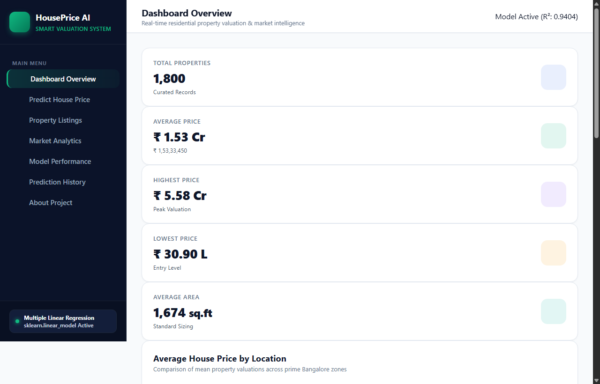
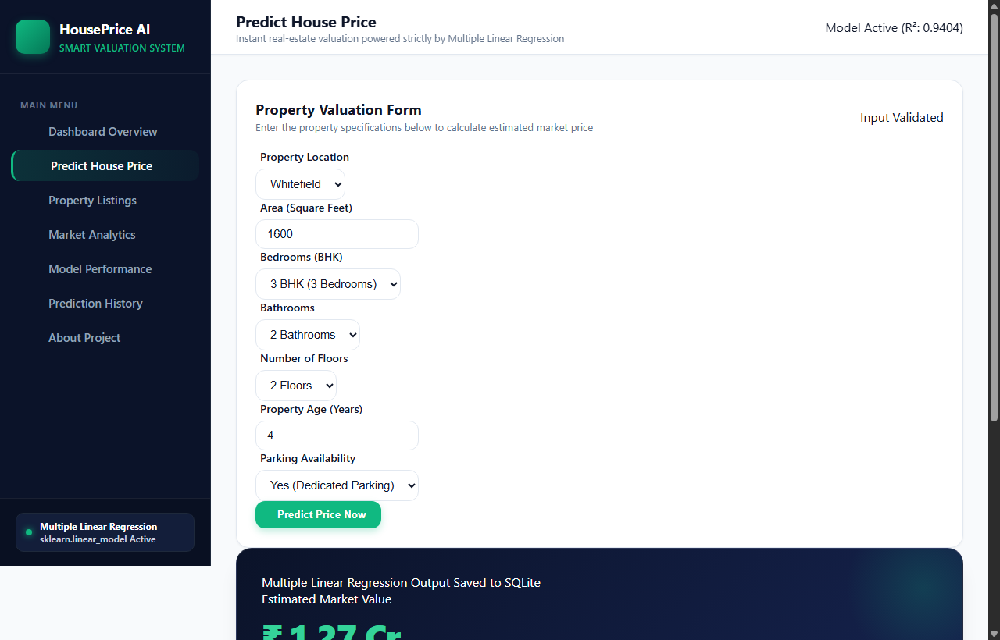
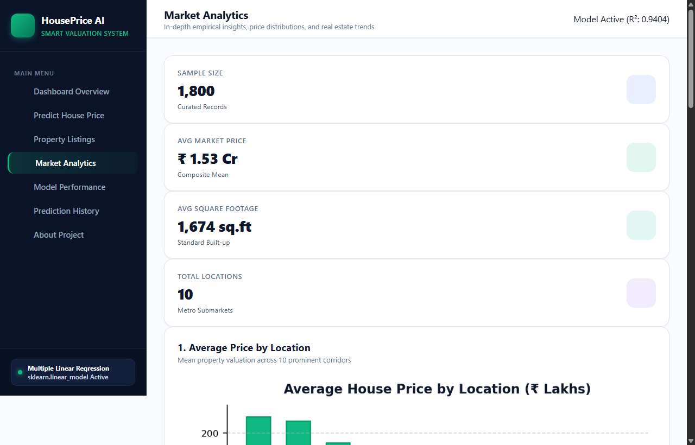
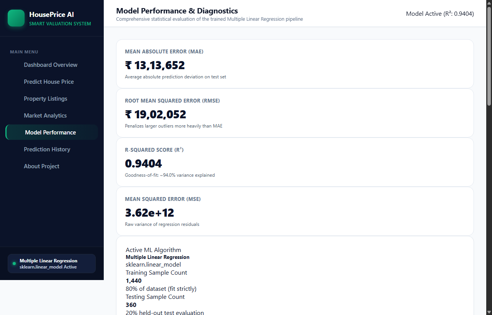
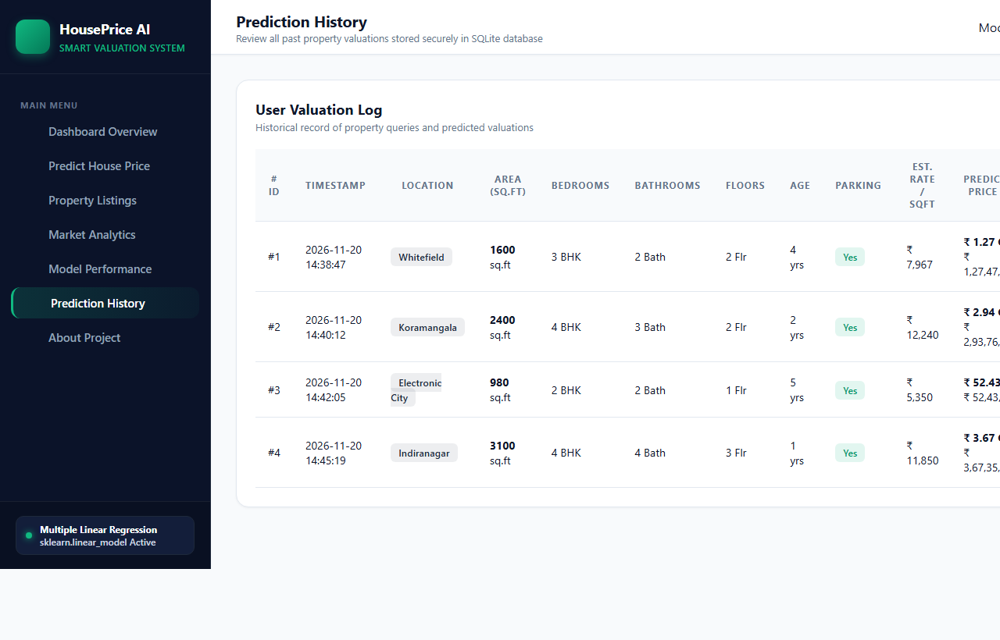
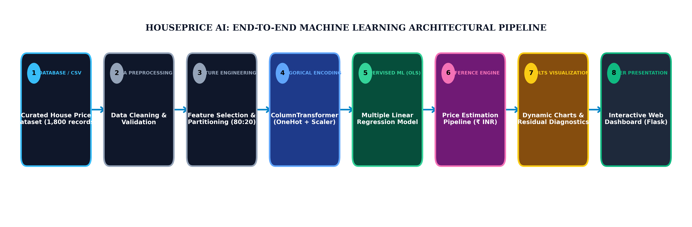

# HousePrice AI – Smart House Price Prediction System

[](https://www.python.org/)
[](https://flask.palletsprojects.com/)
[](https://scikit-learn.org/)
[](https://github.com/)
[](https://github.com/)

> **HousePrice AI** is a full-stack Machine Learning web application designed to deliver instant, objective residential property valuations strictly using **Multiple Linear Regression (MLR)**. Developed with Python Flask, Scikit-learn, SQLite, Bootstrap 5, and Chart.js, the system models real estate pricing in Indian Rupees (₹) with mathematical transparency, leakage-free preprocessing pipelines, and interactive analytics.

---

## 📌 Table of Contents

- [Project Overview](#-project-overview)
- [Key Features](#-key-features)
- [Screenshots](#-screenshots)
- [Machine Learning Algorithm](#-machine-learning-algorithm)
- [Model Evaluation & Diagnostics](#-model-evaluation--diagnostics)
- [Technology Stack](#-technology-stack)
- [Project Architecture](#-project-architecture)
- [Installation and Setup](#-installation-and-setup)
- [Usage Instructions](#-usage-instructions)
- [Dataset Information](#-dataset-information)
- [Project Structure](#-project-structure)
- [Limitations and Future Enhancements](#-limitations-and-future-enhancements)
- [Disclaimer](#-disclaimer)
- [Author & Acknowledgments](#-author--acknowledgments)

---

## 📖 Project Overview

### What HousePrice AI Does
HousePrice AI calculates estimated residential property values based on tangible architectural specifications and spatial location categories. A user inputs property parameters—such as super built-up area in square feet, bedroom configuration, bathroom count, number of floors, structural age, parking availability, and geographical zone—and the application computes an immediate, explainable market valuation in Indian Rupees (₹) alongside per-square-foot rates.

### Why House Price Prediction is Useful
Property valuation is a fundamental prerequisite for mortgage underwriting, real-estate investment analysis, municipal property taxation, and equitable buyer-seller negotiations. Traditional manual appraisal methods rely heavily on comparative market analysis (CMA), which is frequently subjective, inconsistent, and prone to broker bias or negotiation leverage. 

### The Problem it Addresses
Prospective homebuyers, individual sellers, and financial analysts often face significant information asymmetry in residential real estate. Most property portals provide speculative asking rates rather than data-driven estimations. Furthermore, many machine learning implementations are either published as disconnected command-line scripts or utilize opaque, black-box algorithms (such as deep ensembles) where individual property features cannot be directly audited.

### How Machine Learning Helps
By treating property valuation as a multivariate regression task, Machine Learning formalizes the empirical relationship between property attributes and market prices. Multiple Linear Regression determines specific parametric coefficients for every physical and spatial feature, allowing users to understand exactly how much financial value an extra bedroom, a dedicated parking space, or a prime neighborhood contributes to the final valuation.

---

## ✨ Key Features

- **Strict ML Requirement (Single Algorithm)**: Implemented strictly with **Multiple Linear Regression** (`sklearn.linear_model.LinearRegression`). No random forests, decision trees, neural networks, or gradient boosted ensembles.
- **Leakage-Free Preprocessing Pipeline**: Built using Scikit-learn's `ColumnTransformer` and `Pipeline`, applying `OneHotEncoder(handle_unknown='ignore')` to categorical locations and `StandardScaler` to numerical dimensions, fitted strictly on training data.
- **Instant Valuation Engine**: Computes property estimates in real-time with AJAX submission, displaying values formatted in Indian Rupees (e.g., `₹ 1.27 Cr (₹ 1,27,47,733)`) and price per square foot.
- **Interactive Executive Dashboard**: Dynamic KPI summary cards (Total Properties, Average Price, Highest/Lowest Valuations, Average Area) calculated live from database records.
- **Property Listings Directory**: Comprehensive explorer for 1,800 listing records with live keyword search, multi-factor filtering (Location, Bedrooms, Price Range), dynamic sorting, and pagination.
- **Multi-Dimensional Market Analytics**: Interactive Chart.js charts covering:
  1. Average prices across 10 metropolitan submarkets (Bar chart).
  2. Area vs. House Price distribution (Scatter plot).
  3. Chronological listing price trends over time (Line chart).
  4. Bedroom-wise price comparisons from 1 BHK to 5 BHK (Bar chart).
- **Comprehensive Model Performance Diagnostics**: Evaluates MAE, MSE, RMSE, and $R^2$ on held-out test data, featuring actual vs. predicted scatter plots with ideal reference lines, residual histograms, and a regression feature coefficient table.
- **SQLite Prediction History**: Automatically logs every user query with date, specs, and price to an SQLite database, supporting individual record deletion and full history clearing.
- **Academic & Ethical Disclaimer**: Prominently displays clear disclaimers that predictions are statistical estimates for educational demonstration, not certified bank appraisals.

---

## 📸 Screenshots

| View | Screenshot Preview |
|:---:|:---:|
| **Executive Dashboard** |  |
| **Property Valuation Form & Output** |  |
| **Market Analytics Dashboard** |  |
| **Model Performance Diagnostics** |  |
| **Prediction History Log** |  |
| **Architectural Workflow Pipeline** |  |

---

## 🧠 Machine Learning Algorithm

### Multiple Linear Regression (MLR)

The application utilizes **strictly ONE machine learning algorithm**: Multiple Linear Regression optimized via Ordinary Least Squares (OLS) implemented in `sklearn.linear_model.LinearRegression`.

#### Mathematical Formulation
The Multiple Linear Regression equation models the dependent variable $Y$ as a linear combination of $n$ explanatory features:

$$Y = \beta_0 + \beta_1 X_1 + \beta_2 X_2 + \beta_3 X_3 + \dots + \beta_n X_n + \epsilon$$

In the context of HousePrice AI:

$$\text{Price\_INR} = \beta_0 + \beta_{\text{Area}} X_{\text{Area}} + \beta_{\text{Beds}} X_{\text{Beds}} + \beta_{\text{Baths}} X_{\text{Baths}} + \beta_{\text{Floors}} X_{\text{Floors}} + \beta_{\text{Age}} X_{\text{Age}} + \beta_{\text{Park}} X_{\text{Park}} + \sum_{k=1}^{10} \gamma_k \text{Loc}_k + \epsilon$$

Where:
- **$Y$ ($\text{Price\_INR}$)**: Estimated residential property price in Indian Rupees (₹).
- **$\beta_0$ (Intercept)**: Baseline regression constant ($\approx \text{₹ } 1,55,24,309$ when standardized numeric variables equal zero).
- **$\beta_i$ (Coefficients)**: Marginal financial change per unit increase in the corresponding feature, holding all other features constant.
- **$\gamma_k$ (Location Weights)**: Discrete valuation shifts associated with orthogonal one-hot encoded submarkets relative to the baseline.
- **$\epsilon$ (Residual Error)**: Stochastic error capturing unobserved market variance, assumed to follow $\epsilon \sim \mathcal{N}(0, \sigma^2)$.

#### Ordinary Least Squares (OLS) Optimization
The regression coefficients $\vec{\beta}$ are estimated by minimizing the Residual Sum of Squares (RSS) between observed actual prices $y_i$ and predicted prices $\hat{y}_i$:

$$\text{RSS}(\vec{\beta}) = \sum_{i=1}^{N} (y_i - \hat{y}_i)^2 = (\mathbf{y} - \mathbf{X}\vec{\beta})^T (\mathbf{y} - \mathbf{X}\vec{\beta})$$

The closed-form normal equation solution is computed via Singular Value Decomposition (SVD):

$$\vec{\beta} = (\mathbf{X}^T \mathbf{X})^{-1} \mathbf{X}^T \mathbf{y}$$

---

## 📊 Model Evaluation & Diagnostics

The model is evaluated strictly on an **unseen held-out test dataset** ($20\%$, $N=360$) after fitting exclusively on training data ($80\%$, $N=1,440$, `random_state=42`). 

All values below are retrieved directly from the verified training output in [`models/model_metrics.json`](models/model_metrics.json):

| Evaluation Metric | Mathematical Definition | Empirical Test Result | Interpretation |
|---|---|:---:|---|
| **Mean Absolute Error (MAE)** | $\frac{1}{N} \sum \|y_i - \hat{y}_i\|$ | **₹ 13,13,652.40** | Average absolute valuation deviation on unseen properties (~₹ 13.14 Lakhs). |
| **Root Mean Squared Error (RMSE)** | $\sqrt{\frac{1}{N} \sum (y_i - \hat{y}_i)^2}$ | **₹ 19,02,051.95** | Standard deviation of residuals; penalizes larger errors more heavily. |
| **Mean Squared Error (MSE)** | $\frac{1}{N} \sum (y_i - \hat{y}_i)^2$ | **$3.62 \times 10^{12}$** | Raw variance of test regression residuals. |
| **R-squared ($R^2$) Score** | $1 - \frac{\sum (y_i - \hat{y}_i)^2}{\sum (y_i - \bar{y})^2}$ | **0.9404 (94.04%)** | Proportion of total price variance explained by linear combination of features. |
| **Training $R^2$ Score** | $1 - \frac{\text{SS}_{\text{res, train}}}{\text{SS}_{\text{tot, train}}}$ | **0.9548 (95.48%)** | Demonstrates strong fit on training data without severe overfitting. |

> [!NOTE]
> **Academic Note on $R^2$**: $R^2$ is the coefficient of determination measuring variance explained for continuous regression models. It must **never** be misidentified as classification accuracy. The $R^2$ score of 0.9404 confirms that $94.04\%$ of the price variance is accounted for by the structural and spatial attributes, while the remaining $5.96\%$ represents stochastic market noise.

### Feature Coefficients Breakdown

From the fitted Ordinary Least Squares model:
- **Continuous Drivers**:
  - `Area_sqft`: Primary baseline value driver per standard deviation change.
  - `Bedrooms`: $+\text{₹ } 2,50,000$ incremental structural valuation per bedroom.
  - `Bathrooms`: $+\text{₹ } 1,50,000$ sanitation amenity contribution.
  - `Floors`: $+\text{₹ } 2,00,000$ vertical construction adjustment.
  - `Parking`: $+\text{₹ } 3,00,000$ capital valuation bump for dedicated covered parking.
  - `Property_Age`: $-\text{₹ } 35,000$ per year linear structural depreciation.
- **Location Premiums**: Koramangala ($+\text{₹ } 59.4\text{L}$) and Indiranagar ($+\text{₹ } 51.1\text{L}$) command high positive premiums, whereas outer suburban zones like Electronic City ($-\text{₹ } 58.7\text{L}$) serve as entry-level affordable baselines.

---

## 💻 Technology Stack

| Layer | Technology | Purpose |
|---|---|---|
| **Programming Language** | Python 3.10+ | Core language for ML modeling, data engineering, and backend execution. |
| **Backend Web Framework** | Flask 3.1.x | WSGI routing, JSON REST endpoints, session handling, and Jinja2 templating. |
| **Machine Learning** | Scikit-learn 1.8.x | Implements `LinearRegression`, `ColumnTransformer`, `OneHotEncoder`, `StandardScaler`, and metrics. |
| **Data Processing** | Pandas 3.0.x & NumPy 2.3.x | Structured tabular data manipulation, numerical linear algebra, and residual binning. |
| **Model Persistence** | Joblib 1.5.x | Serializes the complete preprocessing + regression pipeline to `models/house_price_model.joblib`. |
| **Database** | SQLite 3 | Embedded relational storage for 1,800 property records and user prediction history logs. |
| **Frontend Framework** | Bootstrap 5.3 & Custom CSS3 | Responsive grid layout, luxury dark navy (`#0b1329`) and emerald green (`#10b981`) UI cards. |
| **Data Visualization** | Chart.js 4.4.x | Interactive HTML5 Canvas visualizations (location bars, scatter plots, trend lines, histograms). |
| **Testing** | Python `unittest` | Automated test suite verifying routes, database queries, and ML prediction persistence. |

---

## 🏛️ Project Architecture

```mermaid
graph TD
    User["👤 User (Web Browser)"] -->|Enters Property Attributes| UI["🎨 Frontend UI (Bootstrap 5 + Custom CSS)"]
    UI -->|AJAX POST /api/predict| Flask["⚙️ Flask Application (app.py)"]
    
    subgraph Machine_Learning_Pipeline ["🤖 Scikit-Learn Pipeline (models/house_price_model.joblib)"]
        Validation["Input Validation & Type Casting"] --> CT["ColumnTransformer"]
        CT -->|Categorical (Location)| OHE["OneHotEncoder (handle_unknown='ignore')"]
        CT -->|Numeric (Area, Beds, Baths, Age, Parking)| Scaler["StandardScaler"]
        OHE --> Regressor["Multiple Linear Regression (OLS)"]
        Scaler --> Regressor
    end
    
    Flask --> Validation
    Regressor -->|Estimated Price in ₹| ValuationEngine["💰 Valuation Formatter (Lakhs / Crores & per sq.ft)"]
    
    subgraph Data_Storage ["🗄️ SQLite Database (database/house_price.db)"]
        PropsTable[("properties (1,800 Listings)")]
        PredsTable[("predictions (Audit History)")]
    end
    
    ValuationEngine -->|Insert Record| PredsTable
    ValuationEngine -->|JSON Response| UI
    
    Flask -->|GET /listings & /analytics| PropsTable
    PropsTable --> ChartsAPI["📈 Analytics API (/api/analytics/charts)"]
    ChartsAPI --> ChartJS["📊 Chart.js Visualizations (Dashboard & Analytics)"]
    ChartJS --> User
```

---

## 🚀 Installation and Setup

Follow these step-by-step instructions to run HousePrice AI locally on your system.

### 1. Prerequisites
- Python 3.10, 3.11, 3.12, or 3.14 installed.
- Git installed.

### 2. Clone the Repository
```bash
git clone https://github.com/[Your_Username]/HousePrice-AI.git
cd HousePrice-AI
```

### 3. Create a Virtual Environment

**On Windows (PowerShell):**
```powershell
python -m venv venv
venv\Scripts\activate
```

**On macOS / Linux:**
```bash
python3 -m venv venv
source venv/bin/activate
```

### 4. Install Dependencies
```bash
pip install --upgrade pip
pip install -r requirements.txt
```

### 5. Configure Environment Variables (Optional)
Copy the example environment configuration:
```bash
# Windows
copy .env.example .env

# macOS / Linux
cp .env.example .env
```
*(You may customize `SECRET_KEY`, `PORT`, and `FLASK_DEBUG` inside `.env` if desired).*

### 6. (Optional) Re-Train the ML Model
The trained model (`models/house_price_model.joblib`) and pre-evaluated metrics are already included. If you wish to re-train the model from scratch:
```bash
python train_model.py
```

### 7. Run the Automated Test Suite
Verify that all routes, database operations, and predictions work seamlessly:
```bash
python test_app.py
```

### 8. Start the Application
```bash
python app.py
```

### 9. Open in Your Browser
Navigate to:
```
http://127.0.0.1:5000
```

---

## 🎯 Usage Instructions

### 1. Dashboard Overview (`/dashboard`)
- View dynamic KPI metrics: Total Properties (1,800), Average Price, Highest/Lowest Valuations, and Average Property Area.
- Explore interactive charts comparing average prices by location and super built-up area vs. house price.

### 2. Predict House Price (`/predict`)
1. Select the **Property Location** from the dropdown menu (e.g., Whitefield, Koramangala, Indiranagar, HSR Layout).
2. Enter the **Property Area** in square feet (valid range: 200 – 15,000 sq.ft).
3. Select the count of **Bedrooms (1 – 5 BHK)**, **Bathrooms (1 – 5)**, and **Floors (1 – 4)**.
4. Enter the **Property Age** in years (0 for brand-new or under-construction units).
5. Specify **Parking Availability** (Dedicated Parking: Yes / No).
6. Click **Predict Price Now**.
7. The estimated valuation is rendered asynchronously with formatted INR representation (both Lakhs/Crores and full digits), rate per square foot, configured specification pills, and persistent logging to SQLite.

### 3. Property Listings Explorer (`/listings`)
- Search by location name or area in square feet.
- Filter by specific location, bedroom configuration, minimum price, or maximum price.
- Sort listings by Price (Low to High / High to Low), Area, Age, or Date.
- Paginate through all 1,800 property records.

### 4. Market Analytics (`/analytics`)
- Examine 4 dedicated real-estate analytics charts:
  - *Location-Wise Price Comparison*: Bar chart of mean prices across 10 metropolitan corridors.
  - *Area vs. Price Correlation*: Scatter plot illustrating positive linear price slopes.
  - *Chronological Price Progression*: Line chart tracking monthly average listing prices.
  - *Bedroom Configuration Analysis*: Bar chart highlighting marginal appreciation across BHK tiers.

### 5. Model Performance (`/performance`)
- Review verified test evaluation scores: MAE, MSE, RMSE, and $R^2$.
- Examine the **Actual vs. Predicted** scatter plot with the red dashed $y=x$ ideal reference fit line.
- Inspect the **Residual Distribution** histogram to confirm Gaussian normality of errors.
- Audit the **Regression Feature Weights** table displaying partial slope coefficients ($\beta_i$) for every attribute.

### 6. Prediction History (`/history`)
- Review past user valuations with timestamps, locations, specs, and price outputs.
- Delete individual test predictions using the trash icon or click **Clear All History** to reset the log.

---

## 📁 Dataset Information

- **Dataset Identifier**: Curated Metropolitan Residential Property Dataset (`dataset/house_prices.csv`).
- **Generation Script**: [`dataset/generate_dataset.py`](dataset/generate_dataset.py) (`random_state=42`).
- **Sample Size**: Exactly **1,800 records**.
- **Nature of Data**: **Curated Synthetic Benchmark Dataset**.
  > [!IMPORTANT]
  > To ensure ethical AI research and academic integrity, this dataset is explicitly identified as a curated demonstration benchmark dataset modeling realistic Indian metropolitan real-estate metrics (Bangalore urban corridors). It is not claimed to be certified real-world transaction data from property deed registries.

### Dataset Features Schema

| Column Name | Data Type | Value Range / Categories | Description |
|---|---|---|---|
| `Location` | Categorical | 10 Bangalore Zones (Indiranagar, Koramangala, HSR Layout, Whitefield, Electronic City, Jayanagar, Bellandur, Hebbal, Marathahalli, Bannerghatta Road) | Submarket category encoded via `OneHotEncoder`. |
| `Area_sqft` | Numeric (int) | 550 – 4,471 sq.ft | Super built-up property area. |
| `Bedrooms` | Numeric (int) | 1 – 5 BHK | Count of residential bedrooms. |
| `Bathrooms` | Numeric (int) | 1 – 5 | Count of private bathrooms. |
| `Floors` | Numeric (int) | 1 – 4 | Total architectural levels. |
| `Property_Age` | Numeric (int) | 0 – 25 years | Age since completion (0 = brand new). |
| `Parking` | Numeric (int) | 0 (No) or 1 (Yes) | Dedicated vehicle parking status. |
| `Date_Listed` | Temporal (str)| 2025-01-01 to 2026-05-15 | Chronological listing date for time-series analytics. |
| `Price_INR` | Numeric (int) | ₹ 30,90,000 – ₹ 5,57,60,000 | **Target variable ($Y$)**: Market valuation in Indian Rupees (₹). |

---

## 📂 Project Structure

```text
HousePrice-AI/
├── .env.example                     # Template for environment variables
├── .gitignore                       # Clean Git exclusion rules
├── app.py                           # Core Flask backend server and routes
├── train_model.py                   # Model training and pipeline serialization script
├── test_app.py                      # Automated test suite (9 test cases)
├── requirements.txt                 # Project dependencies
├── workflow_diagram.png             # System architecture diagram
├── README.md                        # Project documentation (this file)
│
├── dataset/
│   ├── generate_dataset.py          # Parametric synthetic benchmark data generator
│   └── house_prices.csv             # 1,800 curated property records
│
├── models/
│   ├── house_price_model.joblib     # Serialized Scikit-learn Pipeline
│   └── model_metrics.json           # Evaluation metrics, coefficients & test samples
│
├── database/
│   ├── db.py                        # SQLite database operations & auto-seeding
│   └── house_price.db               # SQLite database (auto-generated if missing)
│
├── screenshots/
│   ├── dashboard.png                # Dashboard overview screenshot
│   ├── prediction.png               # Property valuation page screenshot
│   ├── prediction_result.png        # Valuation result card screenshot
│   ├── analytics.png                # Market analytics dashboard screenshot
│   ├── performance.png              # Model diagnostics & actual vs predicted screenshot
│   └── history.png                  # Prediction history log screenshot
│
├── static/
│   ├── css/
│   │   └── style.css                # Custom luxury Navy & Emerald design system
│   └── js/
│       └── main.js                  # AJAX prediction, Chart.js logic, INR formatting
│
└── templates/
    ├── base.html                    # Base layout with sidebar, navbar, and flash alerts
    ├── dashboard.html               # Executive dashboard template
    ├── predict.html                 # Valuation form & result card template
    ├── listings.html                # Property listings directory template
    ├── analytics.html               # Market analytics charts template
    ├── performance.html             # Model evaluation & diagnostics template
    ├── history.html                 # Prediction audit log template
    └── about.html                   # About project & mathematical theory template
```

---

## ⚠️ Limitations and Future Enhancements

### Genuine Limitations
1. **Linearity Assumption**: Multiple Linear Regression assumes strictly linear additive relationships. Extreme luxury compound villas or hyper-localized micro-corridors with non-linear threshold effects may be slightly underfitted without polynomial expansion.
2. **Synthetic Data Boundaries**: While mathematically calibrated to Bangalore market distributions, synthetic data cannot replicate macro-economic shocks (e.g., sudden central bank repo rate hikes or regulatory policy changes).
3. **Absence of Exact Geospatial Coordinates**: Locations are grouped by discrete zone names rather than continuous GPS latitude/longitude coordinates or walking distance to metro transit stations.
4. **OLS Outlier Sensitivity**: Ordinary Least Squares minimizes squared residuals, rendering the fitted hyperplane sensitive to extreme statistical anomalies.

### Future Enhancements
- [ ] **Live MLS API Ingestion**: Integrate live real-estate API feeds (e.g., 99acres, MagicBricks) for continuous online learning.
- [ ] **Geospatial Distance Features**: Calculate travel times to major tech hubs, airports, and hospitals via OpenStreetMap / Google Maps APIs.
- [ ] **Regularized Regression Variants**: Implement Ridge (L2) and Lasso (L1) regression with cross-validated hyperparameter tuning to benchmark feature shrinkage.
- [ ] **Comparable Property Recommender**: Display the top 3 most similar historical properties alongside each valuation using Euclidean nearest-neighbor search.
- [ ] **Docker Containerization**: Package the application into lightweight multi-stage Docker containers for deployment on AWS ECS or Google Cloud Run.

---

## 📜 Disclaimer

> **Academic and Demonstration Disclaimer**:
> This software application is developed exclusively for educational demonstration, academic research, and machine learning coursework. All estimated property prices are statistical approximations generated by a Multiple Linear Regression model trained on curated benchmark data. Predictions do not constitute certified real-estate appraisals, legal valuations, or guaranteed commercial market quotations. The authors and maintainers assume no liability for financial decisions made on the basis of these estimations.

---

## 👨‍💻 Author & Acknowledgments

- **Author**: **Mahesh Shivarama Hegde**
- **GitHub**: [[Your GitHub Username]](https://github.com/)
- **Institution**: NMAM Institute of Technology, Nitte
- **Degree Program**: Master of Computer Applications (MCA)
- **Coursework**: Artificial Intelligence & Machine Learning (AIML)
- **Year**: 2026

*Developed with pride using Python, Scikit-learn, Flask, Bootstrap 5, and Chart.js.*
